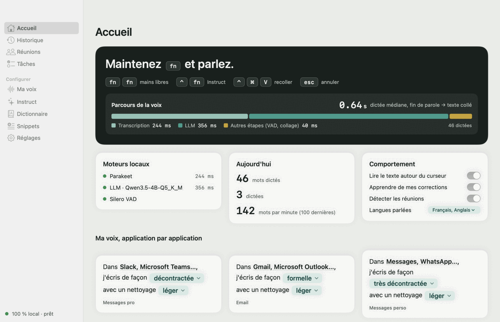
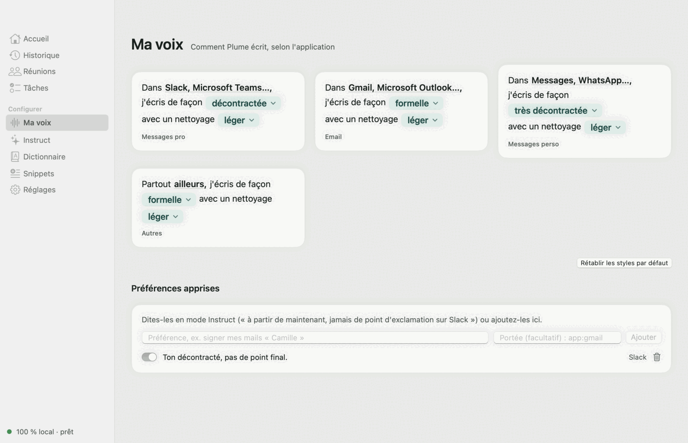
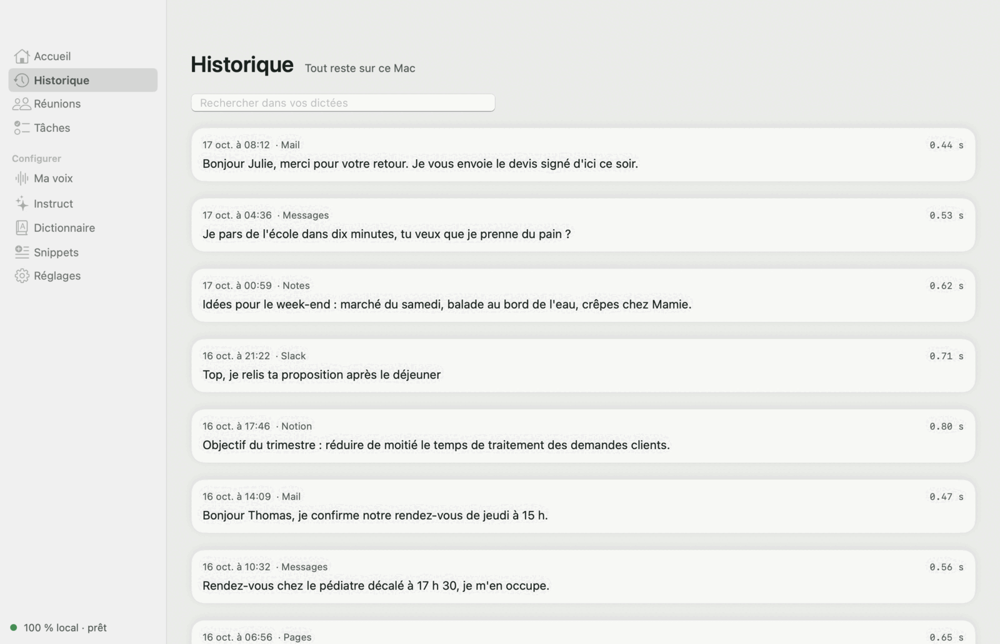
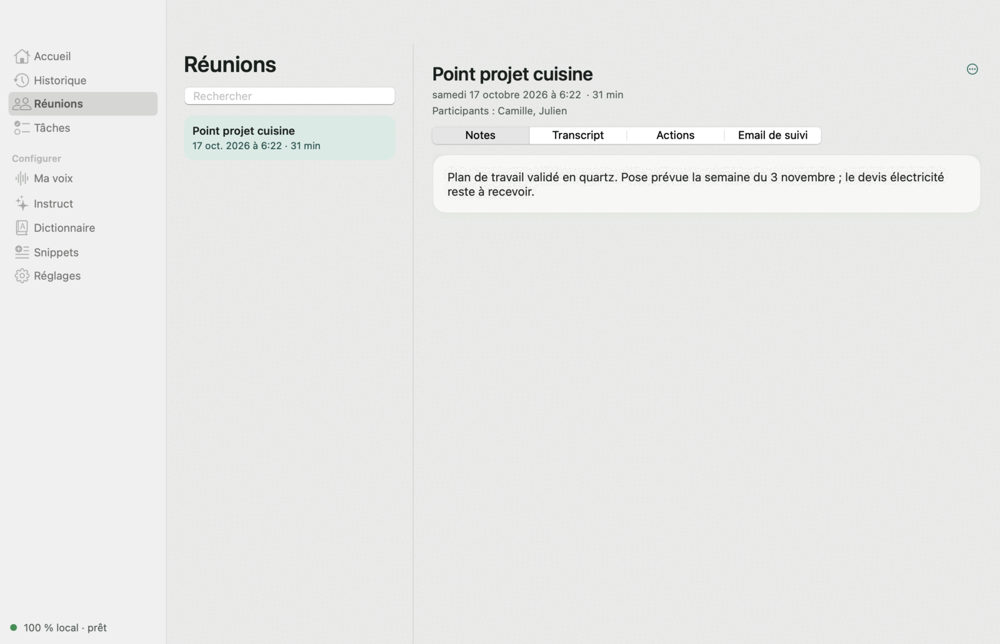
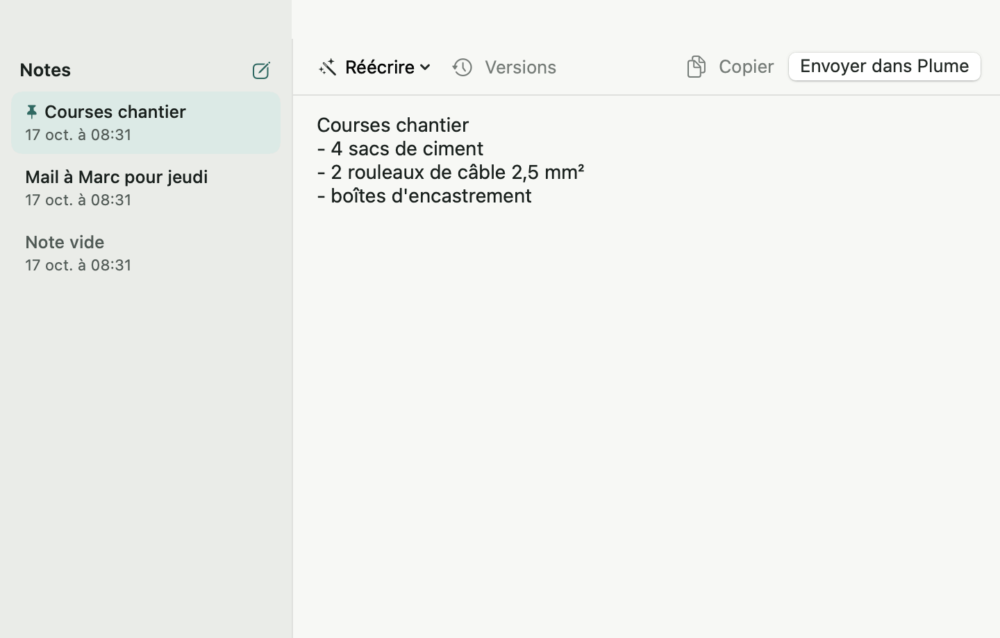

<div align="center">


# Plume

**Maintenez fn, parlez. C'est écrit.**<br />
Dictée vocale pour macOS, 100 % locale : la voix et le texte ne quittent jamais le Mac.

[](../../releases/latest)
&nbsp;

&nbsp;


[](https://github.com/samr037/plume/actions/workflows/ci.yml)
[](https://github.com/samr037/plume/actions/workflows/codeql.yml)
[](https://scorecard.dev/viewer/?uri=github.com/samr037/plume)
[](SECURITY.md#verifying-a-download)
[](../../releases)


<sub>[English](README.md) · Français</sub>

</div>

---

## Ce que fait Plume

<table>
<tr>
<td width="50%" valign="top">

### 🎙️ Dicter partout
Maintenez **fn** dans n'importe quelle app, parlez, relâchez. Le texte arrive au curseur, ponctué, sans les « euh », en moins d'une seconde.

### ✍️ Une voix par app
Formel dans Mail, décontracté dans Messages, sobre dans Slack. Chaque style se règle en une phrase.

### 🔒 Rien ne sort du Mac
Pas de compte, pas de serveur. Transcription et mise au propre tournent sur la puce Apple. Seuls les modèles sont téléchargés, une fois.

</td>
<td width="50%" valign="top">

### 👥 Réunions
Plume repère les appels (Meet, Zoom, Teams…), transcrit, sépare les interlocuteurs et rédige compte rendu, tâches et mail de suivi.

### ⚡ Réécrire et demander
Sélectionnez un texte et réécrivez-le (⌃⌥1…9 : plus court, plus formel, en anglais…). Avec **⌃ puis fn**, demandez : « réponds-lui que c'est d'accord pour jeudi ».

### 📝 Bloc-notes
**⌃⌥N** ouvre un bloc-notes à dicter, puis à envoyer dans l'app de votre choix.

</td>
</tr>
</table>

<picture>
  <source media="(prefers-color-scheme: dark)" srcset="docs/media/fr/hub-home-dark.png" />
  
</picture>

<table>
<tr>
<td width="50%"><picture><source media="(prefers-color-scheme: dark)" srcset="docs/media/fr/hub-voice-dark.png" /></picture><p align="center"><sub>Ma voix : un style par application</sub></p></td>
<td width="50%"><picture><source media="(prefers-color-scheme: dark)" srcset="docs/media/fr/hub-history-dark.png" /></picture><p align="center"><sub>Historique, recherchable, sur le Mac</sub></p></td>
</tr>
<tr>
<td width="50%"><picture><source media="(prefers-color-scheme: dark)" srcset="docs/media/fr/hub-meetings-dark.png" /></picture><p align="center"><sub>Réunions : notes, transcription, tâches</sub></p></td>
<td width="50%"><picture><source media="(prefers-color-scheme: dark)" srcset="docs/media/fr/scratchpad-dark.png" /></picture><p align="center"><sub>Bloc-notes (⌃⌥N)</sub></p></td>
</tr>
</table>

## Confidentialité

Plume n'a ni compte, ni télémétrie, ni serveur. Le réseau sert à une seule chose : télécharger les modèles au premier lancement.

| Connexion | Quand | Où le vérifier |
|---|---|---|
| Hugging Face : Parakeet, VAD, diarisation (FluidAudio) | Premier lancement | [`Engines.swift`](Sources/Plume/Engines.swift) |
| Hugging Face : Qwen3.5 4B (≈ 3 Go) | Premier lancement | [`Downloads.swift`](Sources/Plume/Downloads.swift) |
| Hugging Face : Whisper | Seulement si vous choisissez Whisper | [`Engines.swift`](Sources/Plume/Engines.swift) |
| `127.0.0.1:8081` (llama-server embarqué) | À chaque dictée, sans quitter le Mac | [`Engines.swift`](Sources/Plume/Engines.swift) |

Une fois les modèles en place, rien de ce que vous dictez ne sort du Mac. Pour signaler une faille : [SECURITY.md](SECURITY.md).

## Installer

> [!NOTE]
> Il faut un Mac Apple Silicon (M1 ou plus récent), macOS 14 ou plus, et environ 5 Go libres.

1. Téléchargez `Plume-x.y.z.dmg` dans les **[Releases](../../releases/latest)** et glissez Plume dans Applications.
2. Ouvrez Plume. macOS la bloque la première fois (app gratuite, sans certificat Apple payant) : **Réglages Système › Confidentialité et sécurité › Ouvrir quand même**.
3. Suivez le guide de bienvenue. Plume télécharge ses modèles (≈ 4 Go, une barre suit la progression) et demande le **Micro** et l'**Accessibilité**.

> [!TIP]
> Réglages Système › Clavier › « Appuyer sur 🌐 pour » → **Ne rien faire**, pour que fn ne déclenche pas les emojis.

Après une mise à jour, macOS peut demander de réactiver Plume dans Accessibilité : décochez puis recochez-la.

## Raccourcis


| Geste | Effet |
|---|---|
| Maintenir **fn** | Dicter ; relâcher colle le texte |
| Double-tap **fn** ou **fn + espace** | Mains libres ; **fn** pour terminer |
| **fn** + une autre touche, ou **Échap** | Annuler |
| **⌃⌘V** | Recoller la dernière dictée |
| **⌃⌥1…9** | Réécrire la sélection |
| **⌃⌥N** | Bloc-notes |
| **⌃** puis **fn** | Instruct : rédiger, traduire, répondre, retenir une préférence |

La barre flottante se place sur n'importe quel bord de l'écran. Un clic lance une dictée mains libres, un clic droit ouvre le menu.

## Sous le capot

| | |
|---|---|
| Transcription | [Parakeet](https://huggingface.co/FluidInference) sur le Neural Engine (Core ML, via FluidAudio) ; Whisper large-v3 turbo en option (WhisperKit) |
| Mise au propre | Qwen3.5 4B (GGUF) servi par [llama.cpp](https://github.com/ggml-org/llama.cpp), embarqué dans l'app |
| Détection de voix | Silero VAD |
| Interlocuteurs | Diarisation hors ligne (pyannote / WeSpeaker, Core ML) |
| App | Swift natif, SwiftUI, SQLite ; aucune dépendance réseau hors téléchargement des modèles |

<details>
<summary><b>Compiler depuis les sources</b></summary>

```sh
scripts/test.sh                      # tests
WL_SIGN=- scripts/build-app.sh       # ~/Applications/Plume.app, signature ad hoc
scripts/make-dmg.sh ~/Applications/Plume.app dist/Plume.dmg
```

Sans `WL_SIGN`, le script crée un certificat local « Plume Dev » : macOS garde alors l'autorisation d'Accessibilité d'un build à l'autre. Les releases sont produites par GitHub Actions à chaque tag `v*` (`.github/workflows/release.yml`).

Diagnostic : `--selftest fichier.wav`, `--bench a.wav b.wav`, `--instruct "demande"`, `--snapshot <dossier>` (avec `WL_DB=<base de démo>` pour des captures sans données personnelles ; `wl-mcp --seed <chemin>` crée cette base).

La vidéo de démo est une composition [HyperFrames](https://github.com/heygen-com/hyperframes) : `cd docs/video && npx hyperframes render -c index.fr.html -o ../media/fr/plume-demo.mp4`.

`wl-mcp` expose l'historique, les réunions et les tâches à un client MCP (voir [docs/mcp.md](docs/mcp.md)).

**Architecture**
- `Sources/PlumeCore` : machine d'états du raccourci, post-traitement, filtres, prompts, stockage SQLite (testé)
- `Sources/MeetingKit` : détection des appels, capture micro et son système
- `Sources/Plume` : app (raccourci global, audio, moteurs, collage, interface SwiftUI)
- `Sources/wl-mcp` : serveur MCP local en lecture seule

</details>

## Licence

MIT, voir [LICENSE](LICENSE). Composants et modèles tiers : [THIRD_PARTY_NOTICES](Resources/THIRD_PARTY_NOTICES.md).

Plume est un projet indépendant, sans lien avec un autre éditeur de logiciel de dictée.
