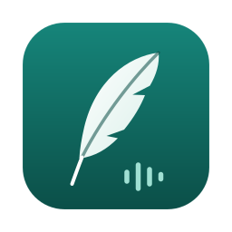
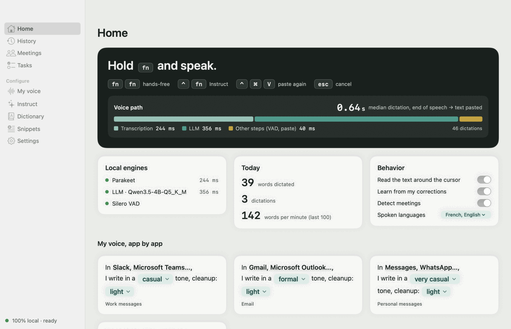
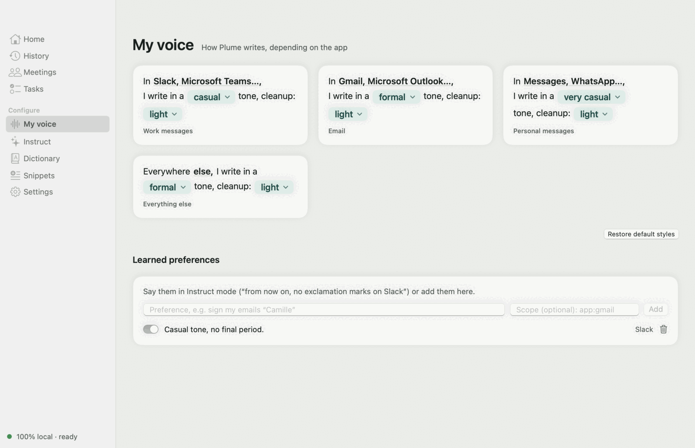
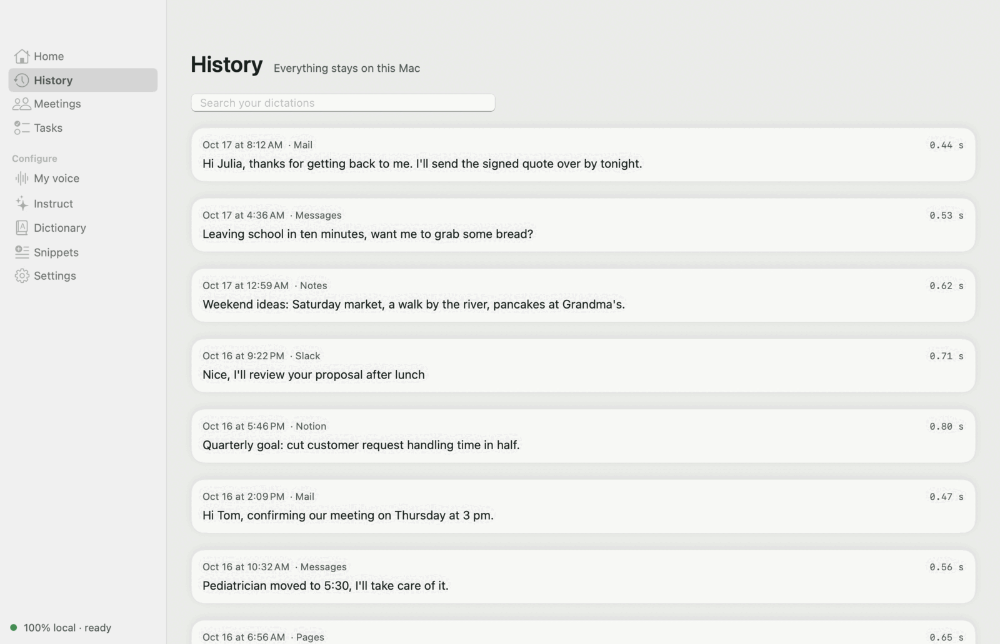
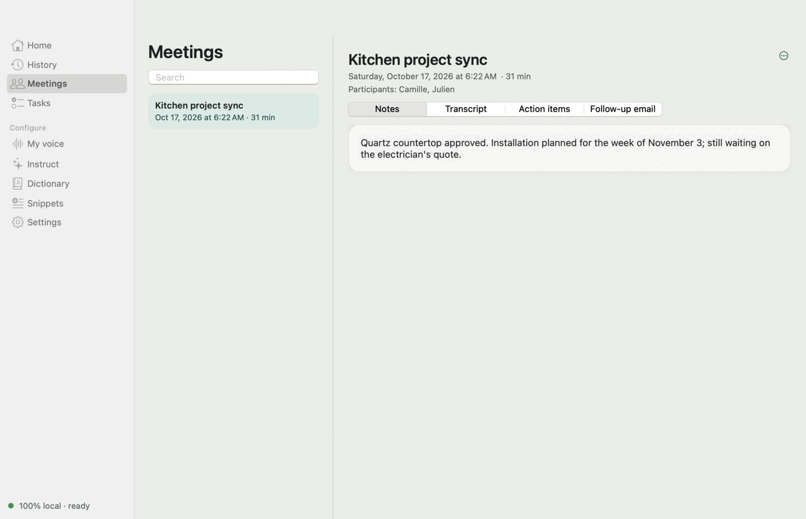
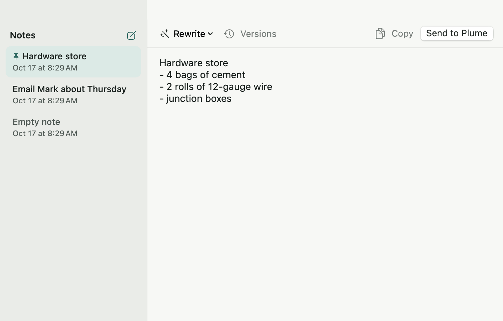
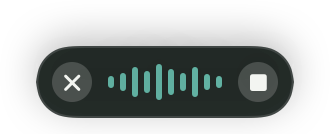

<div align="center">



# Plume

**Hold fn, speak. It's written.**<br />
Voice dictation for macOS that runs 100% on your Mac: your voice and your text never leave it.

[](../../releases/latest)
&nbsp;

&nbsp;


[](https://github.com/samr037/plume/actions/workflows/ci.yml)
[](https://github.com/samr037/plume/actions/workflows/codeql.yml)
[](https://scorecard.dev/viewer/?uri=github.com/samr037/plume)
[](SECURITY.md#verifying-a-download)
[](../../releases)


<sub>English · [Français](README.fr.md)</sub>

</div>

---

## What Plume does

<table>
<tr>
<td width="50%" valign="top">

### 🎙️ Dictate anywhere
Hold **fn** in any app, speak, release. The text lands at your cursor, punctuated and free of "ums", in under a second.

### ✍️ A voice per app
Formal in Mail, casual in Messages, crisp in Slack. Each style is set in one sentence.

### 🔒 Nothing leaves your Mac
No account, no server. Transcription and cleanup run on Apple silicon. Only the models are downloaded, once.

</td>
<td width="50%" valign="top">

### 👥 Meetings
Plume spots calls (Meet, Zoom, Teams…), transcribes them, tells speakers apart and drafts notes, action items and a follow-up email.

### ⚡ Rewrite and ask
Select text and rewrite it (⌃⌥1…9: shorter, more formal, in French…). With **⌃ then fn**, just ask: "tell her Thursday works for me".

### 📝 Scratchpad
**⌃⌥N** opens a notepad to dictate into, then send to the app of your choice.

</td>
</tr>
</table>

<picture>
  <source media="(prefers-color-scheme: dark)" srcset="docs/media/hub-home-dark.png" />
  
</picture>

<table>
<tr>
<td width="50%"><picture><source media="(prefers-color-scheme: dark)" srcset="docs/media/hub-voice-dark.png" /></picture><p align="center"><sub>My voice: one style per app</sub></p></td>
<td width="50%"><picture><source media="(prefers-color-scheme: dark)" srcset="docs/media/hub-history-dark.png" /></picture><p align="center"><sub>Searchable history, kept on your Mac</sub></p></td>
</tr>
<tr>
<td width="50%"><picture><source media="(prefers-color-scheme: dark)" srcset="docs/media/hub-meetings-dark.png" /></picture><p align="center"><sub>Meetings: notes, transcript, action items</sub></p></td>
<td width="50%"><picture><source media="(prefers-color-scheme: dark)" srcset="docs/media/scratchpad-dark.png" /></picture><p align="center"><sub>Scratchpad (⌃⌥N)</sub></p></td>
</tr>
</table>

## Privacy

Plume has no account, no telemetry and no server. It uses the network for one thing only: downloading models on first launch.

| Connection | When | Where to check |
|---|---|---|
| Hugging Face: Parakeet, VAD, diarization (FluidAudio) | First launch | [`Engines.swift`](Sources/Plume/Engines.swift) |
| Hugging Face: Qwen3.5 4B (≈ 3 GB) | First launch | [`Downloads.swift`](Sources/Plume/Downloads.swift) |
| Hugging Face: Whisper | Only if you pick Whisper | [`Engines.swift`](Sources/Plume/Engines.swift) |
| `127.0.0.1:8081` (bundled llama-server) | Every dictation, without leaving the Mac | [`Engines.swift`](Sources/Plume/Engines.swift) |

Once the models are in place, nothing you dictate leaves your Mac. To report a vulnerability, see [SECURITY.md](SECURITY.md).

## Install

> [!NOTE]
> Requires an Apple Silicon Mac (M1 or later), macOS 14 or later, and about 5 GB of free space.

1. Download `Plume-x.y.z.dmg` from **[Releases](../../releases/latest)** and drag Plume to Applications.
2. Open Plume. macOS blocks it the first time (free app, no paid Apple certificate): **System Settings › Privacy & Security › Open Anyway**.
3. Follow the welcome guide. Plume downloads its models (≈ 4 GB, with a progress bar) and asks for **Microphone** and **Accessibility** access.

> [!TIP]
> System Settings › Keyboard › "Press 🌐 key to" → **Do Nothing**, so fn doesn't open the emoji picker.

After an update, macOS may ask you to re-enable Plume under Accessibility: uncheck it, then check it again.

## Shortcuts



| Gesture | Action |
|---|---|
| Hold **fn** | Dictate; release to paste |
| Double-tap **fn** or **fn + space** | Hands-free; **fn** to finish |
| **fn** + any other key, or **Esc** | Cancel |
| **⌃⌘V** | Paste the last dictation again |
| **⌃⌥1…9** | Rewrite the selection |
| **⌃⌥N** | Scratchpad |
| **⌃** then **fn** | Instruct: draft, translate, reply, remember a preference |

The floating bar docks to any screen edge. Click it to start a hands-free dictation; right-click for the menu.

## Under the hood

| | |
|---|---|
| Transcription | [Parakeet](https://huggingface.co/FluidInference) on the Neural Engine (Core ML, via FluidAudio); Whisper large-v3 turbo optional (WhisperKit) |
| Cleanup | Qwen3.5 4B (GGUF) served by [llama.cpp](https://github.com/ggml-org/llama.cpp), bundled in the app |
| Voice detection | Silero VAD |
| Speakers | Offline diarization (pyannote / WeSpeaker, Core ML) |
| App | Native Swift, SwiftUI, SQLite; no network dependency beyond model downloads |

The interface is available in English and French and follows your macOS language.

<details>
<summary><b>Build from source</b></summary>

```sh
scripts/test.sh                      # tests
WL_SIGN=- scripts/build-app.sh       # ~/Applications/Plume.app, ad hoc signature
scripts/make-dmg.sh ~/Applications/Plume.app dist/Plume.dmg
```

Without `WL_SIGN`, the script creates a local "Plume Dev" certificate so macOS keeps the Accessibility permission across builds. Releases are built by GitHub Actions on every `v*` tag (`.github/workflows/release.yml`).

Diagnostics: `--selftest file.wav`, `--bench a.wav b.wav`, `--instruct "request"`, `--snapshot <dir>` (with `WL_DB=<demo db>` for screenshots without personal data; `WL_SEED_LANG=en wl-mcp --seed <path>` creates that database).

The demo video is a [HyperFrames](https://github.com/heygen-com/hyperframes) composition: `cd docs/video && npx hyperframes render -c index.html -o ../media/plume-demo.mp4`.

`wl-mcp` exposes history, meetings and tasks to an MCP client (see [docs/mcp.md](docs/mcp.md), in French).

**Layout**
- `Sources/PlumeCore`: hotkey state machine, post-processing, filters, prompts, SQLite storage (tested)
- `Sources/MeetingKit`: call detection, microphone and system audio capture
- `Sources/Plume`: the app (global hotkey, audio, engines, pasting, SwiftUI interface)
- `Sources/wl-mcp`: local read-only MCP server

</details>

## License

MIT, see [LICENSE](LICENSE). Third-party components and models: [THIRD_PARTY_NOTICES](Resources/THIRD_PARTY_NOTICES.md).

Plume is an independent project, not affiliated with any other dictation software vendor.
